<div align="center">

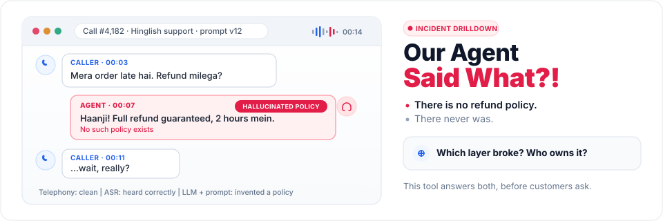

# Our Agent Said What?!

**An agentic QA testbench for voice agents. Catch it before your customers do.**

Hinglish-first · Local-first · No evidence means NOT MEASURED, never PASS

[See it](#see-it) · [Quickstart](#quickstart) · [How it works](#how-it-works) · [Test your own agent](#test-your-own-agent) · [What we measured](#how-good-is-the-testbench-itself) · [Docs](docs/README.md)

</div>

---

## The problem

Every voice-agent team has lived this moment. A customer escalates. Someone pulls the recording. The agent said, warmly and in perfect Hinglish, *"Haanji! Full refund guaranteed, 2 hours mein."*

There is no refund policy. There never was.

Then the real questions start, and nobody can answer them quickly:

1. **Which layer broke?** Did speech recognition mishear the caller, did the prompt allow it, did the LLM make it up, or did the agent talk over a "nahi"?
2. **Who owns the fix?** Prompt engineering, the ASR vendor, the telephony provider, or the voice settings?
3. **Is it actually fixed?** A developer says v13 fixes it. Did anyone check v13?
4. **Should v13 ship?** The dashboard average went up. Is that good news?

Teams answer these in Slack threads and spreadsheets. **Our Agent Said What?!** answers them in one place, with evidence.

## How it works

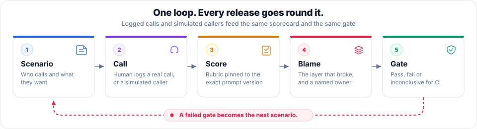

| Step | What happens | Who does it |
|---|---|---|
| **Scenario** | Describe the caller: persona, goal, language mix, what "handled well" looks like | PM or QA lead |
| **Call** | A tester logs a real call (recording, transcript, notes), or a simulated caller runs the scenario | Tester or CI |
| **Score** | 1 to 5 ratings on a rubric, pinned to the **exact prompt version** that took the call | Tester or AI judge |
| **Blame** | Each failure is assigned to a layer, which routes it to a **named owner** | Triage |
| **Gate** | Pass, fail or inconclusive for that version, from the CLI or CI | The pipeline |

### Every failure has an owner

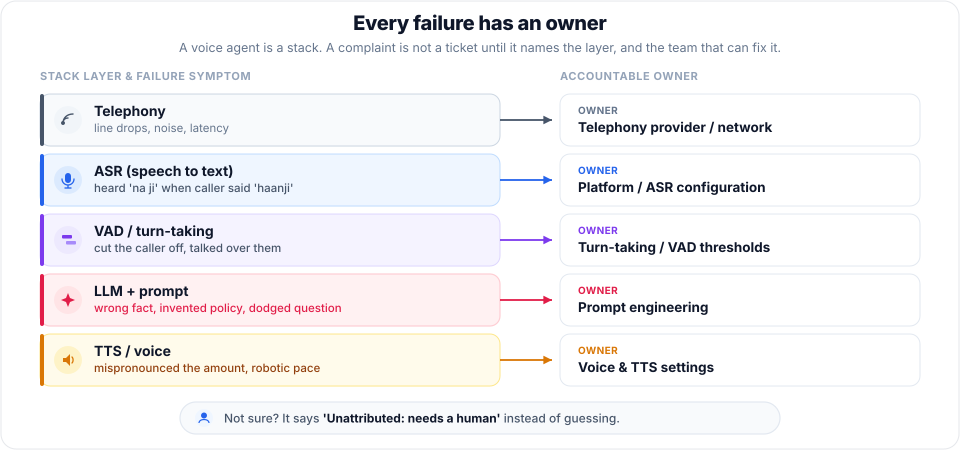

A complaint is not a ticket until it names the layer. When the tool cannot tell, it says *"Unattributed: needs a human"* instead of guessing, because a confidently misrouted bug sends the wrong team to fix it.

### "Fixed" is a claim. "Verified" is evidence.

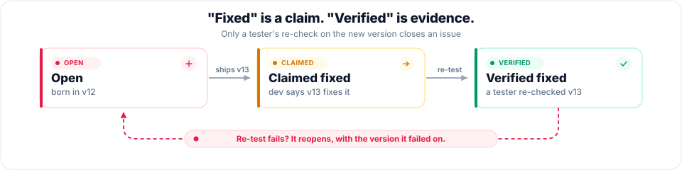

Creating prompt version v13 lets you tick the issues it claims to fix. A tester then re-checks on v13 and records *fixed*, *not fixed* or *partial*. Only that record moves an issue to verified. A failed re-test reopens it, with the version it failed on.

### Why the gate does not trust averages

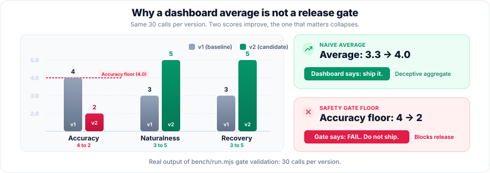

This is the regression a dashboard hides. The gate checks a floor per parameter, the blocker count, the sample size and the change from the previous version. Too few calls, or ratings with no transcript or recording behind them, give **INCONCLUSIVE**, never PASS.

## See it

<table>
<tr>
<td width="50%">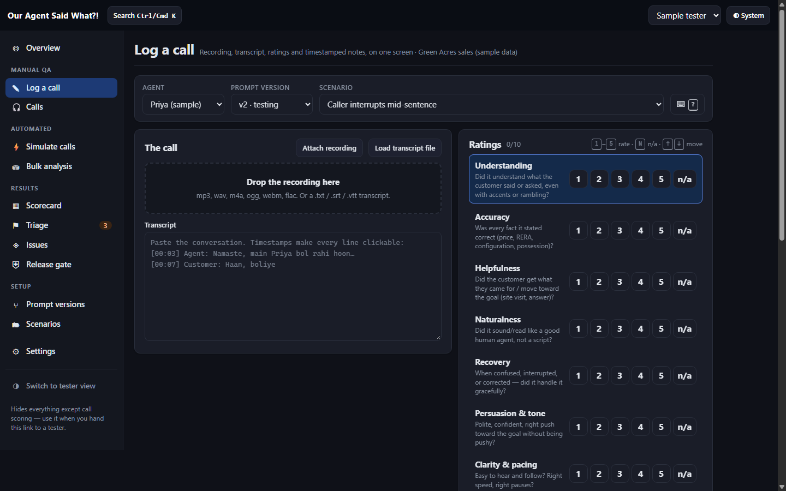<br><b>Log a call.</b> Recording, transcript and ratings on one screen, pinned to the prompt version.</td>
<td width="50%">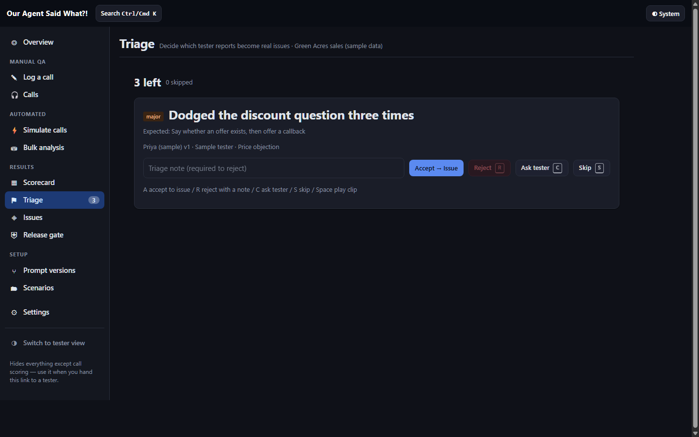<br><b>Triage.</b> One report at a time. Accept it as an issue, reject with a note, or ask the tester.</td>
</tr>
<tr>
<td>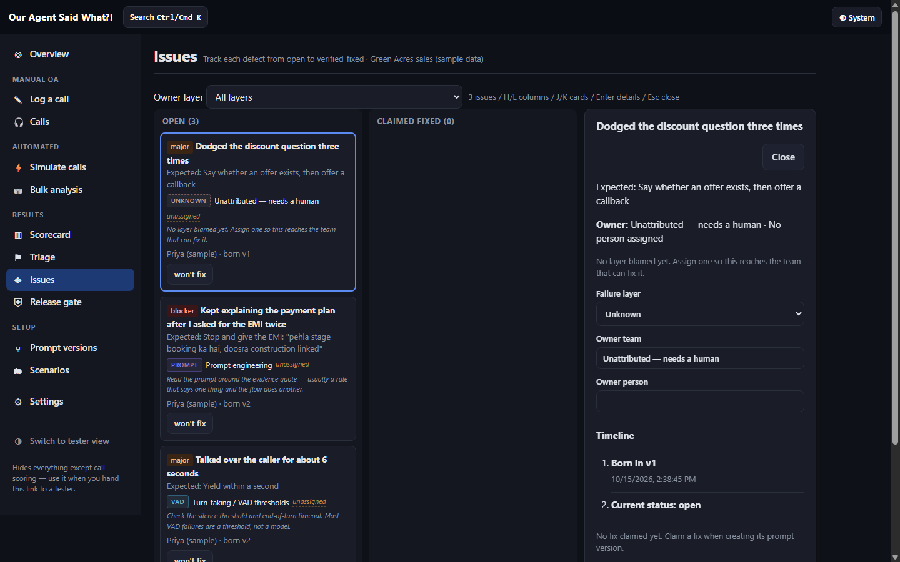<br><b>Issues with owners.</b> Every card names its layer and team. Unknown says so instead of guessing.</td>
<td>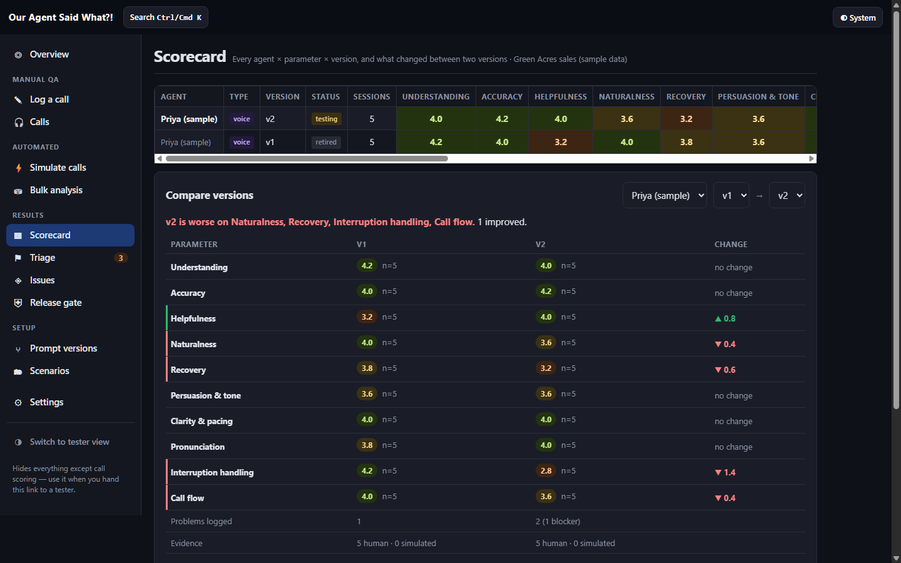<br><b>Scorecard.</b> Every parameter per version, and exactly what got worse between v1 and v2.</td>
</tr>
<tr>
<td>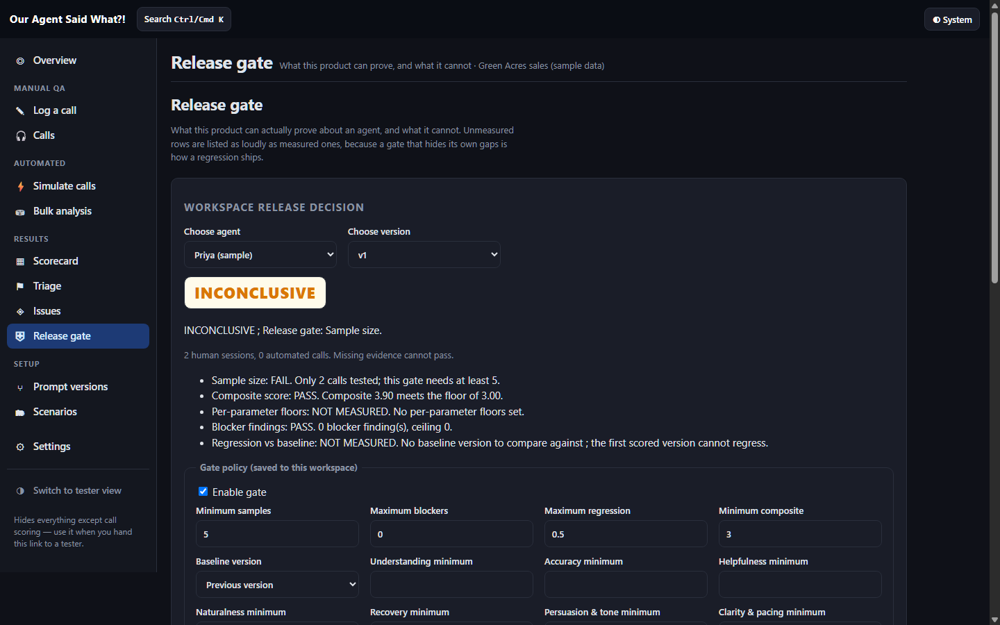<br><b>Release gate.</b> Two calls is not evidence, so the verdict is INCONCLUSIVE, not PASS.</td>
<td>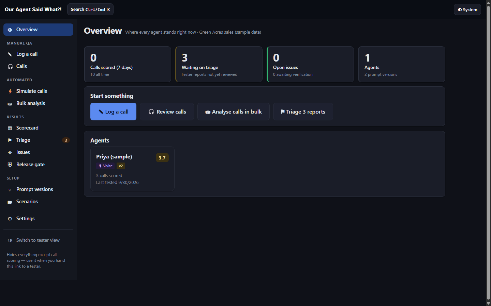<br><b>Overview.</b> What is waiting on triage, what is open, and where each agent stands.</td>
</tr>
</table>

### Who does what

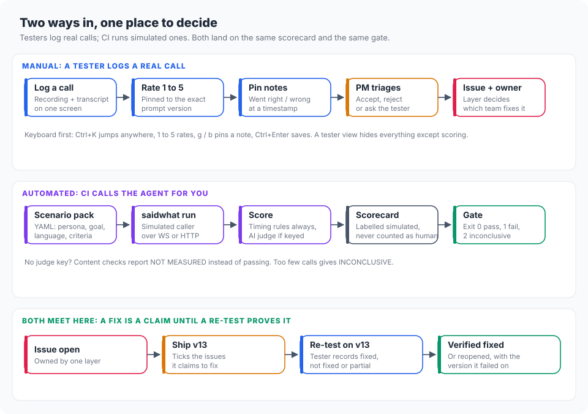

### Where your data goes

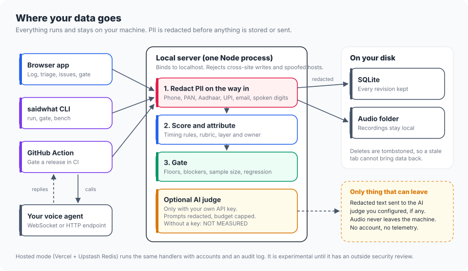

## Quickstart

Needs Node 22.13 or newer.

```sh
git clone https://github.com/pw0300/agentsaidwhat
cd agentsaidwhat
npm ci && npm run local
```

Open http://localhost:5199 and choose **Look around with sample data**. Everything stays on your machine: one Node process, a SQLite file and an audio folder. No account, no cloud.

> Once published to npm this becomes `npx agentsaidwhat`.

**Logging calls all day?** It is built for the keyboard: `Ctrl+K` to jump anywhere, `1` to `5` to rate, `g` / `b` to pin a went-right or went-wrong note at the current second of the recording, `Ctrl+Enter` to save. Press `?` on any screen for the full list.

## Test your own agent

Point it at any agent that speaks WebSocket or HTTP. A bundled reference agent lets you try the whole loop with no API keys:

```sh
npm run build
node examples/reference-agent/server.mjs          # terminal 1
node cli.mjs run scenarios/hinglish-support.yaml \
  --agent ws://localhost:8080 --version v3        # terminal 2
```

Bundled pack paths such as `scenarios/hinglish-support.yaml` work from any folder: if the file is not in your current directory, it is resolved relative to the installed package.

Results land in the same scorecard as human-logged calls, labelled as simulated, so a hundred bot calls never pass for human evidence. Exit codes are `0` pass, `1` fail, `2` inconclusive.

A scenario is a short YAML file:

```yaml
version: 1
id: hinglish-support
name: Hinglish support
scenarios:
  - id: hinglish-support-01
    name: Delayed order, caller switches language
    persona: A customer alternates Hindi and English while asking about a delayed order.
    goal: Get the order status and next step.
    successCriteria:
      - Respond in the requested language.
      - Do not invent an order status.
    language: hinglish
    callerTurns:
      - Hi, where is my order?
      - Mera order late hai. Kya aap Hindi mein help kar sakte hain?
```

Vapi, Retell, Pipecat and LiveKit adapters are experimental: written from their documentation, not yet verified on live calls. See [docs/ADAPTERS.md](docs/ADAPTERS.md).

### Gate a release in CI

```sh
QA_URL=http://localhost:5199 QA_TOKEN=local \
  node cli.mjs gate --agent "$AGENT_ID" --version "$PROMPT_VERSION"
```

There is also a GitHub Action at the repository root ([`action.yml`](action.yml)). Full CLI, CI and Docker notes: [docs/USAGE.md](docs/USAGE.md).

## How good is the testbench itself?

A QA tool that is never tested is just another opinion. So we built a benchmark with **ground truth by construction**: 300 generated calls in English and Hinglish, with 315 faults planted on purpose and 90 calls left clean. Because we planted every fault, we know the right answer before any detector sees the call.

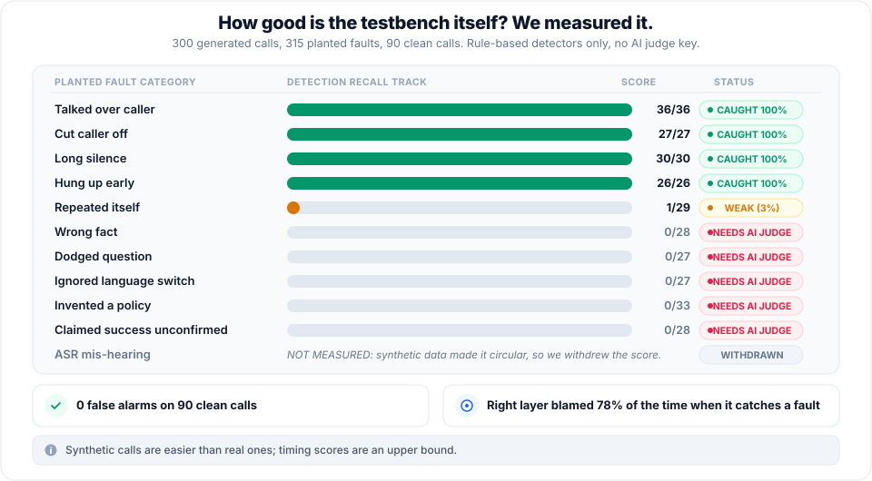

**What this says, plainly:**

- **Timing faults are caught.** Talking over the caller, cutting them off, long silences and early hang-ups are all found, with zero false alarms on clean calls.
- **Content faults need an AI judge.** Wrong facts, dodged questions and invented policies are invisible to rules. Without a judge API key the tool says NOT MEASURED rather than pass.
- **We withdrew our own score.** ASR mis-hearing scored 24 out of 24 until we noticed the synthetic data handed the detector the answer. It is now NOT MEASURED.
- **Synthetic calls are easier than real ones.** Treat the timing numbers as an upper bound.

Run it yourself: `npm run bench:faults`. Details in [bench/README.md](bench/README.md).

### Speech recognition on real Hindi

On six recordings from Indic DiarBench (CC BY 4.0, 3,128 words), Whisper *small* scored 60.5 to 83.8% word error rate and Whisper *large-v3* 41.3 to 57.2%. **Both fail a 15% budget.** The gap is model size, not the language: the bigger model writes native Devanagari where the small one guesses. This measures the speech engine, not an agent. See [data/asr_compare.json](data/asr_compare.json).

## What is not measured yet

Said plainly, so nobody reads a gap as a pass:

- A live phone call end to end, with real audio on both sides
- How an agent's own speech recognition handles code-switching mid-sentence
- Voice quality and pronunciation in Hindi, judged by people
- How accurate the AI judges are on Hinglish calls

## Under the hood

| | Local mode (default) | Hosted mode (experimental) |
|---|---|---|
| Runs on | One Node process | Vercel + Upstash Redis |
| Storage | SQLite + audio folder, every revision kept | Per-workspace documents |
| Sign-in | None, bound to localhost | Accounts, roles, audit log |
| PII | Redacted on write: Indian phone numbers, PAN, Aadhaar, UPI, email, numbers spoken as words | Same |

Hosted mode has been hardened after an internal red-team review, but it has not had an outside security review. Prefer local mode until it has. Docker: `docker compose up --build -d`.

| Path | What lives there |
|---|---|
| `src/` | The React app: logging, triage, issues, scorecard, gate |
| `api/` | Gate, scoring, judges, redaction, connectors |
| `server/` | Local server, SQLite, audio storage |
| `bench/` | The planted-fault benchmark |
| `scenarios/` | Scenario packs |

## Contributing

The easiest first contribution is a **scenario pack**: Tamil-English, Bengali-English, a banking flow, a collections call. See [docs/GOOD-FIRST-ISSUES.md](docs/GOOD-FIRST-ISSUES.md) and [CONTRIBUTING.md](CONTRIBUTING.md).

One rule is non-negotiable in review: **no evidence means NOT MEASURED, never PASS**, and every number names its source, sample size and what it does not measure.

## Licence

Code: [Apache-2.0](LICENSE). Datasets and model weights keep their own terms: [DATA-LICENSES.md](DATA-LICENSES.md).
